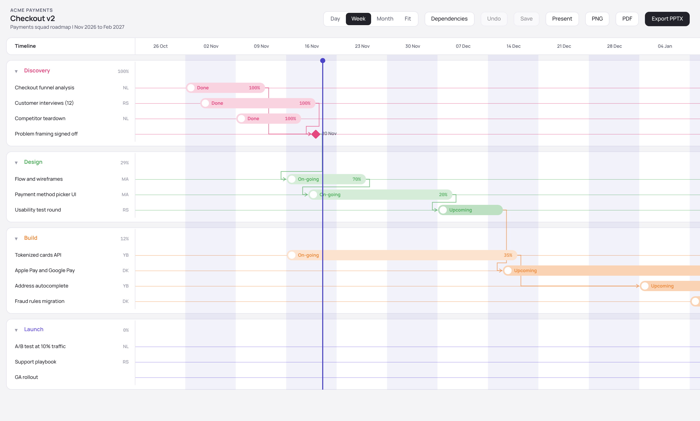
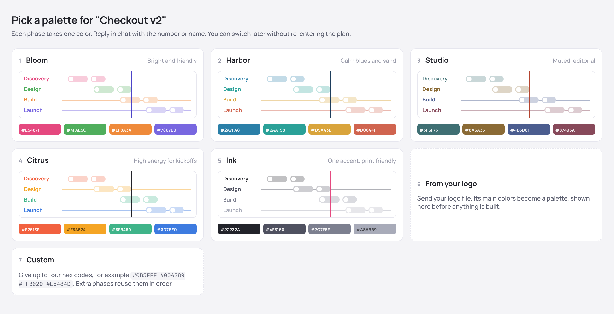
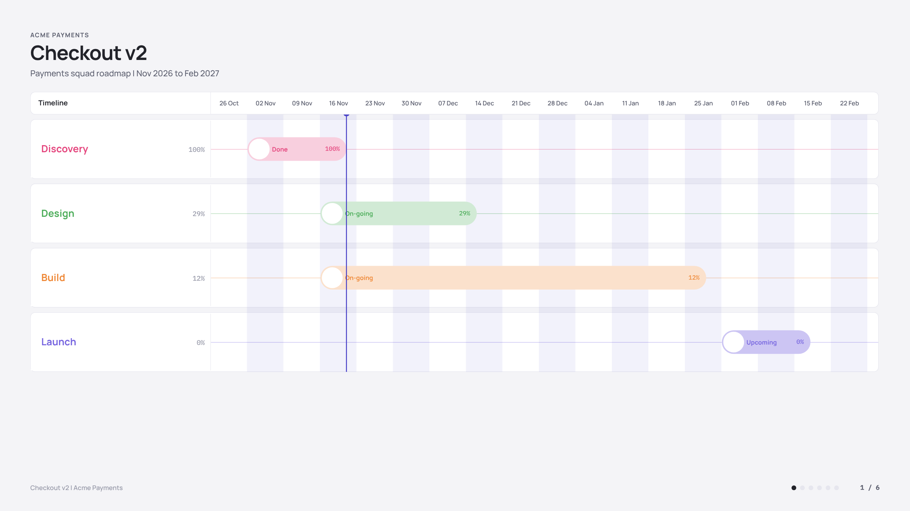
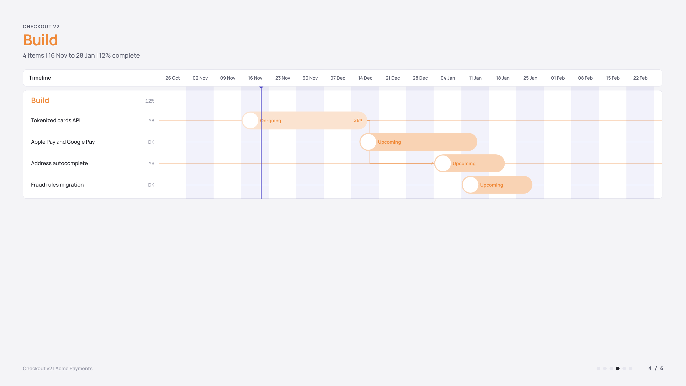

# gantt

**Roadmap Gantt charts, built from a short conversation.**

An agent skill for product managers that works in [Claude Code](https://claude.com/claude-code), [Codex](https://developers.openai.com/codex/skills) and [Cursor](https://cursor.com/docs/skills). It interviews you, shows you palette options, and hands back one self-contained HTML file you can drag, present full screen, and export to PNG, PDF or an editable PowerPoint deck.



## Install

You need [Node](https://nodejs.org) 18 or newer and at least one of Claude Code, Codex or Cursor.

```bash
git clone https://github.com/shachafnave/gantt
```

```bash
cd gantt && ./install.sh
```

That installs the skill for every supported agent, user-wide, as links back to the clone:

| Agent | Installed at | Start it with |
| --- | --- | --- |
| Claude Code | `~/.claude/skills/gantt` | `/gantt` |
| Codex | `~/.codex/skills/gantt` | `$gantt`, or pick it from `/skills` |
| Cursor | reads the Claude Code and Codex folders | `/gantt` in Agent chat |

Or just ask for a Gantt chart: every agent picks the skill up from its description. Options:

- `./install.sh codex` (or `claude`, `cursor`) installs for one agent only. `./install.sh cursor` on its own uses `~/.cursor/skills`.
- `--project` installs into the current project (`.claude/skills`, `.agents/skills`, `.cursor/skills`) instead of user-wide.
- `--copy` copies the files instead of linking them. `--uninstall` removes what was installed.
- Inside this repo nothing needs installing: `.claude/skills/gantt` and `.agents/skills/gantt` are committed.

To update, `git pull` in the clone. Linked installs pick the change up in the next session.

## Use

In your agent, ask for a Gantt ("build me a roadmap for the Q1 onboarding revamp") or start the skill directly (`/gantt` in Claude Code and Cursor, `$gantt` in Codex). Attach a spreadsheet, paste a PRD, or start from nothing. The skill always runs a short interview before it draws anything:

1. **Source:** interview from scratch, paste text or a document, a CSV or Excel file, or pull from Jira, monday.com or Linear through your agent's connectors or MCP servers.
2. **Titles:** chart title, subtitle, and a title for each group (phase card). Suggested from your source, confirmed by you.
3. **Gaps:** only what the source didn't give: dates, owners, dependencies, milestones. Batched, never invented.
4. **Branding:** organization name and logo. Attach an image and it goes into the header.
5. **Palette:** shown as an image in the chat, five built-in palettes, one pulled from your logo, or your own hex codes, then picked from a prompt.
6. **Build:** a summary to approve, then the chart and a preview image.

Files land in `gantt/<plan-name>/`: `plan.json`, the chart HTML, and your logo. Say "skip the questions" if you really want defaults.



## The chart

- Phase cards with status pills (Done, On-going, Overdue, Upcoming), percent complete, owners, milestones, dependency arrows and a Today line.
- Drag a bar to move it, drag its edges to change dates, Ctrl or Cmd+Z to undo.
- Day, Week, Month and Fit zoom. Click a group to collapse it.
- **Save** downloads a copy of the file with your edits inside. Replace the old file with it.
- **Present** (or press P): full-screen 16:9 slides. An overview, one slide per group (long groups split across slides), and a milestones slide. Arrow keys or click to move, Esc to exit, `#slide-3` in the address opens a specific slide.
- **PNG** exports a sharp image of the whole chart. **PDF** opens the print dialog fitted to a landscape page. **PPTX** has the same slides as Present mode, drawn as native shapes you can edit in PowerPoint or Keynote.

| Present mode overview | One slide per group |
| --- | --- |
|  |  |

To change a chart later, ask your agent to update it. It reads the plan back out of the HTML, including edits you saved.

## Plan format

Charts are built from a small JSON file, so you can also write or generate plans yourself:

```json
{
  "title": "Checkout v2",
  "subtitle": "Payments squad | Q1 2027",
  "org": "Acme Payments",
  "logo": "logo.png",
  "palette": "bloom",
  "phases": [
    { "name": "Discovery", "tasks": [
      { "id": "t1", "name": "Funnel analysis", "owner": "NL", "start": "2026-11-02", "end": "2026-11-12", "pct": 100 },
      { "id": "m1", "name": "Framing signed off", "milestone": true, "start": "2026-11-20", "deps": ["t1"] }
    ]}
  ]
}
```

The full reference, including the field mapping for Jira, monday.com and Linear, is in [`skill/gantt/reference/plan-schema.md`](skill/gantt/reference/plan-schema.md). A complete example is in [`skill/gantt/examples/checkout-v2.json`](skill/gantt/examples/checkout-v2.json).

## Scripts

The skill's scripts live in `skill/gantt/scripts` and use only the Node standard library:

| Command | Does |
| --- | --- |
| `node build.mjs plan.json [out.html]` | Validate a plan and build the chart |
| `node palette-page.mjs --title T --phases "A,B" out.html` | Build the palette chooser |
| `node csv-to-plan.mjs tasks.csv plan.json` | Convert a task list |
| `node render-png.mjs page.html out.png` | Screenshot the palette chooser or a chart (needs Playwright) |
| `node extract.mjs chart.html [plan.json]` | Read a plan back out of a chart |

## Privacy

Your plan stays on your machine. The chart is a static file with no analytics, tracking or server. It makes two kinds of network requests, both only to public CDNs:

- Fonts (Manrope, IBM Plex Mono) from Google Fonts when the chart opens. Without a connection it falls back to system fonts.
- The export libraries, [PptxGenJS](https://github.com/gitbrent/PptxGenJS) and [html-to-image](https://github.com/bubkoo/html-to-image), from jsDelivr the first time you export PPTX or PNG. Nothing from your plan is sent; the files are built in your browser.

When you use the skill, your agent (Claude Code, Codex or Cursor) processes your plan like any other conversation content, under that provider's terms.

## Development

```bash
npm install
```

```bash
npm test
```

The smoke test builds the example plan and drives the chart in headless Chromium: drag, resize, undo, zoom, collapse, save, presenter mode, PNG and PPTX export, and hostile input. It needs Playwright with Chromium. `npm run screenshots` refreshes the images in `media/`. See [CONTRIBUTING.md](CONTRIBUTING.md).

## Credits

Exports use [PptxGenJS](https://github.com/gitbrent/PptxGenJS) (MIT) and [html-to-image](https://github.com/bubkoo/html-to-image) (MIT), loaded at runtime. Type is set in [Manrope](https://fonts.google.com/specimen/Manrope) and [IBM Plex Mono](https://fonts.google.com/specimen/IBM+Plex+Mono) (SIL Open Font License).

## License

[MIT](LICENSE)
